# Hi there, I'm Shahab Khan 👋

<div align="center">

### Software Engineering Student @ Iqra University | Islamabad, Pakistan

[](https://git.io/typing-svg)

[](https://github.com/shahabkhan4636)
[](https://github.com/shahabkhan4636)
[](mailto:shahabkhanprofessional@gmail.com)

</div>

---

### 👨‍💻 About Me

```javascript
const shahab = {
    location: "Islamabad, Pakistan 📍",
    education: "Software Engineering @ Iqra University",
    role: "Frontend Developer & Tool Maker",
    mission: "Build free, clean and useful tools for Pakistan & India",
    principles: ["100% Original Code", "No Copyright", "No Payment", "No Watermark"],
    focus: ["Web Tools", "PWA", "APIs", "Image & Video Tools"],
    motto: "Code should help people — for free."
};
```

> I love building tools that people actually use every day. No ads spam, no paywalls — just clean, fast, and useful web apps.

---

### 🚀 Featured Projects — Live Websites

All projects are **live, fast, and mobile-friendly**. Click to try!

| # | Project | What it does | Tech | Live Demo |
|---|---------|--------------|------|-----------|
| **1** | **🔥 ViralTools.pk** <br> *13 Viral Tools in One* | Stylish Name Generator, Fancy Text, Love Calculator, YouTube Thumbnail Downloader, Password Generator, Age & BMI Calculator, QR Code, Hashtags, Color Picker, Voice Tools & more | `HTML` `CSS` `JavaScript` | [**▶️ Visit Live**](https://viraltools-pk.netlify.app/) |
| **2** | **📈 PakDailyLive.pk** <br> *Daily Live Rates Pakistan* | Live Gold Rate Today, USD to PKR, Petrol Price, Namaz Time (Karachi/Lahore/Islamabad), Qibla Compass, Tasbih Counter | `JavaScript` `Live APIs` `PWA` | [**▶️ Visit Live**](https://pakdailylive-pk.netlify.app/) |
| **3** | **🖼️ ImageTools.pk** <br> *8 Free Image Tools* | Background Remover (No Watermark), Image Compressor, Passport Size Photo Maker (NADRA CNIC), Image Resizer, JPG to PNG, Image to PDF, Add Urdu Text, Blur Background | `Canvas API` `jsPDF` | [**▶️ Visit Live**](https://imagetools-pk.netlify.app/) |
| **4** | **📥 VideoDownloader.pk** <br> *TikTok No Watermark* | TikTok Video Downloader HD No Watermark, Instagram Reels, Facebook Video HD, YouTube Shorts Thumbnail, WhatsApp Status Saver | `TikWM API` `PWA` | [**▶️ Visit Live**](https://videodownloader-pk.netlify.app/) |
| **5** | **🧮 SmartCalculator.pk** <br> *Scientific Calculator* | Free scientific calculator — sin/cos/tan, log, √, π, keyboard support, safe parser, works offline | `HTML` `CSS` `JavaScript` | [**▶️ Visit Live**](https://shahabkhan4636.github.io/SmartCalculator.pk/) |
| **6** | **🐍 SnakeGame.pk** <br> *Classic Snake Game* | Snake game in browser — keyboard + mobile controls, high scores, increasing speed, pause | `Canvas API` `JavaScript` | [**▶️ Visit Live**](https://shahabkhan4636.github.io/SnakeGame.pk/) |
| **7** | **🌤️ WeatherApp.pk** <br> *Live Weather App* | Live weather for any city — temperature, humidity, wind & 5-day forecast via Open-Meteo API | `Fetch API` `Open-Meteo` | [**▶️ Visit Live**](https://shahabkhan4636.github.io/WeatherApp.pk/) |
| **8** | **✅ TodoApp.pk** <br> *Todo List App* | Add, edit, complete & filter tasks — auto-saved in browser with localStorage, no sign-up | `JavaScript` `localStorage` | [**▶️ Visit Live**](https://shahabkhan4636.github.io/TodoApp.pk/) |
| **9** | **👨‍💻 Portfolio** <br> *Personal Portfolio* | My personal portfolio website showcasing all projects, skills & contact | `HTML` `CSS` `JavaScript` | [**▶️ Visit Live**](https://shahabkhan4636.github.io/Portfolio/) |
| **10** | **📝 QuizApp.pk** <br> *MCQ Quiz App* | Fun quiz — Programming, Pakistan GK, Math & General Knowledge, timer, score & results | `HTML` `CSS` `JavaScript` | [**▶️ Visit Live**](https://shahabkhan4636.github.io/QuizApp.pk/) |
| **11** | **🎮 TicTacToe.pk** <br> *Tic-Tac-Toe vs AI* | Play against unbeatable minimax AI, easy/hard modes, score tracking | `JavaScript` `Minimax` | [**▶️ Visit Live**](https://shahabkhan4636.github.io/TicTacToe.pk/) |
| **12** | **🖌️ DrawingApp.pk** <br> *Online Drawing* | Draw with colors & brushes, eraser, download art as PNG, touch support | `Canvas API` `JavaScript` | [**▶️ Visit Live**](https://shahabkhan4636.github.io/DrawingApp.pk/) |
| **13** | **💱 CurrencyConverter.pk** <br> *Live Currency Converter* | Real-time conversion for 15 currencies via Frankfurter API, swap & quick pairs | `Fetch API` `Frankfurter API` | [**▶️ Visit Live**](https://shahabkhan4636.github.io/CurrencyConverter.pk/) |

<div align="center">

**✨ All 13 projects are FREE — No Signup | No Watermark | Works on Mobile ✨**

</div>

---

### 📸 Live Previews

<div align="center">

#### 🔥 ViralTools.pk — 13 Tools in 1
<a href="https://viraltools-pk.netlify.app/" target="_blank"></a>
<br>
<em>Stylish Names, Fancy Text, YT Thumbnail, QR, Password & more — All in one dashboard</em>

<br><br>

##### 🧮 SmartCalculator.pk — Scientific Calculator
<a href="https://shahabkhan4636.github.io/SmartCalculator.pk/" target="_blank">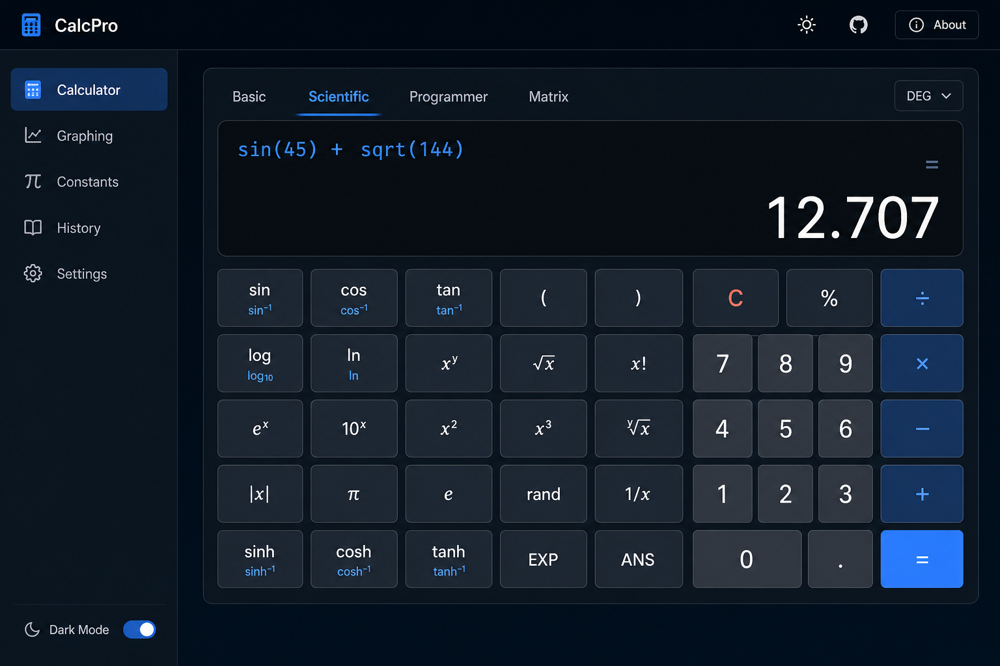</a>
<br>

#### 🐍 SnakeGame.pk — Classic Snake Game
<a href="https://shahabkhan4636.github.io/SnakeGame.pk/" target="_blank">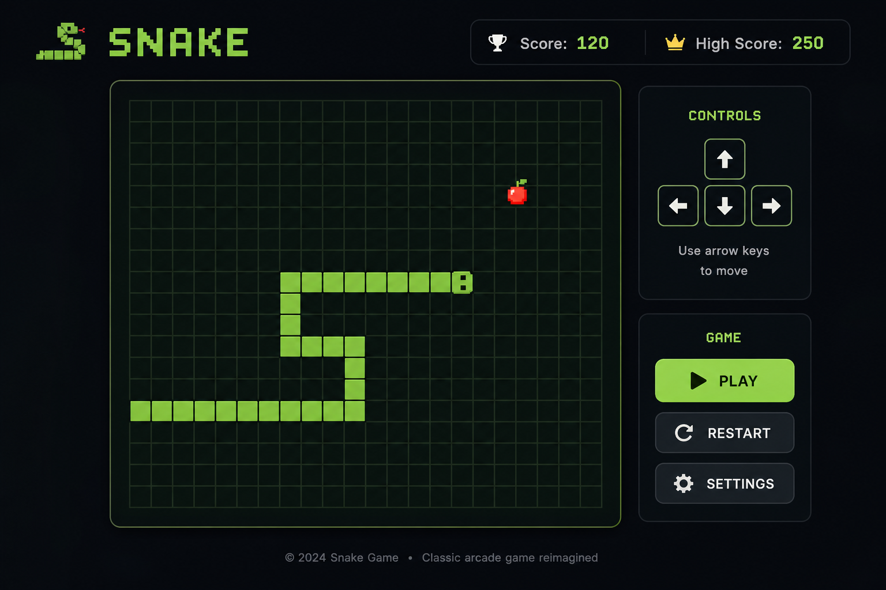</a>
<br>

#### 🌤️ WeatherApp.pk — Live Weather
<a href="https://shahabkhan4636.github.io/WeatherApp.pk/" target="_blank">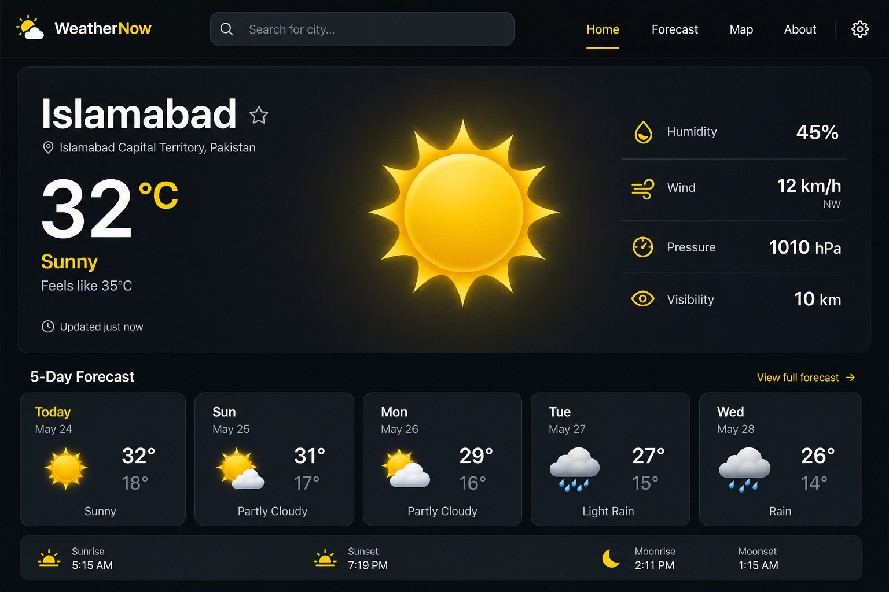</a>
<br>

#### ✅ TodoApp.pk — Todo List
<a href="https://shahabkhan4636.github.io/TodoApp.pk/" target="_blank">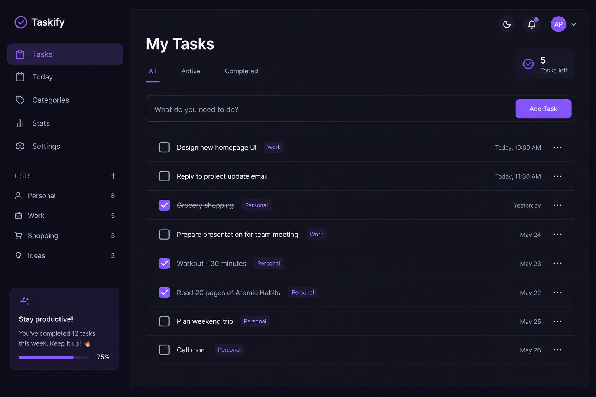</a>
<br>

---

#### 📝 QuizApp.pk — MCQ Quiz
<a href="https://shahabkhan4636.github.io/QuizApp.pk/" target="_blank">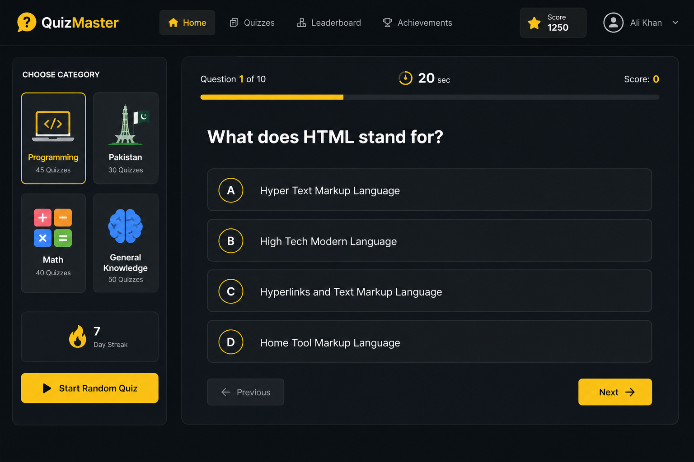</a>
<br>

#### 🎮 TicTacToe.pk — vs AI
<a href="https://shahabkhan4636.github.io/TicTacToe.pk/" target="_blank">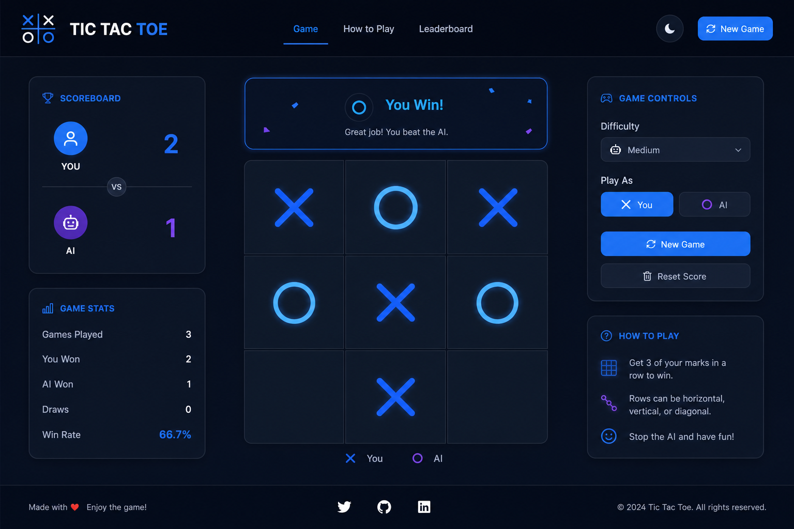</a>
<br>

#### 🖌️ DrawingApp.pk — Draw Online
<a href="https://shahabkhan4636.github.io/DrawingApp.pk/" target="_blank">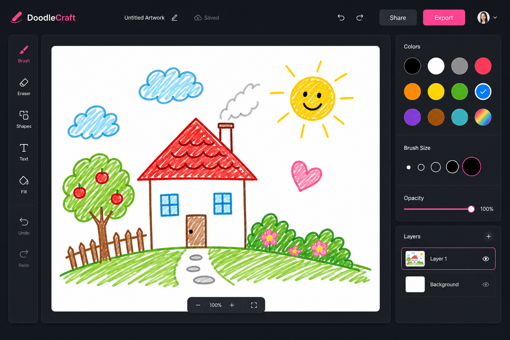</a>
<br>

#### 💱 CurrencyConverter.pk — Live Rates
<a href="https://shahabkhan4636.github.io/CurrencyConverter.pk/" target="_blank">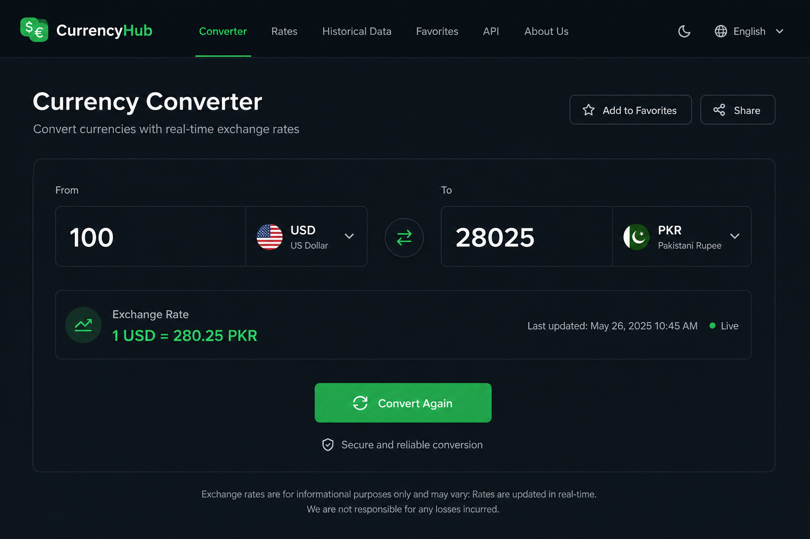</a>
<br>

---

### 📈 PakDailyLive.pk — Daily Live Rates Pakistan
<a href="https://pakdailylive-pk.netlify.app/" target="_blank">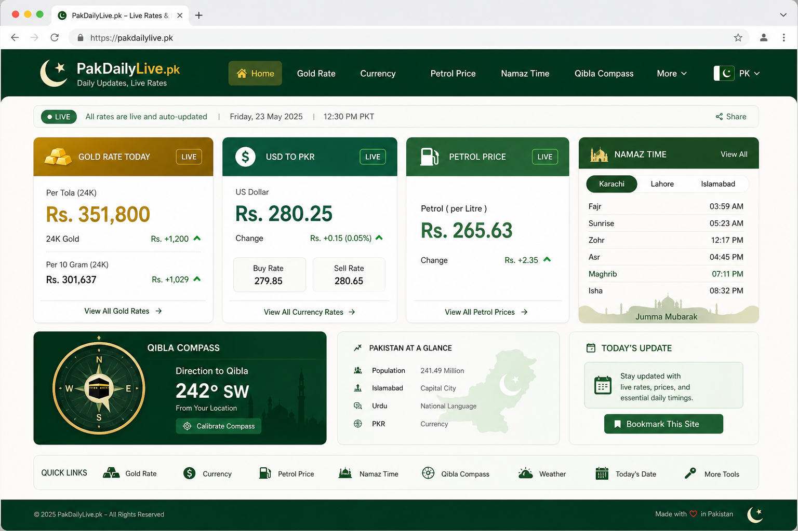</a>
<br>
<em>Gold Rate Rs. 351,800 | USD to PKR Rs. 280.25 | Petrol | Namaz Time | Qibla 242° SW</em>

<br><br>

#### 🖼️ ImageTools.pk — 8 Image Tools
<a href="https://imagetools-pk.netlify.app/" target="_blank">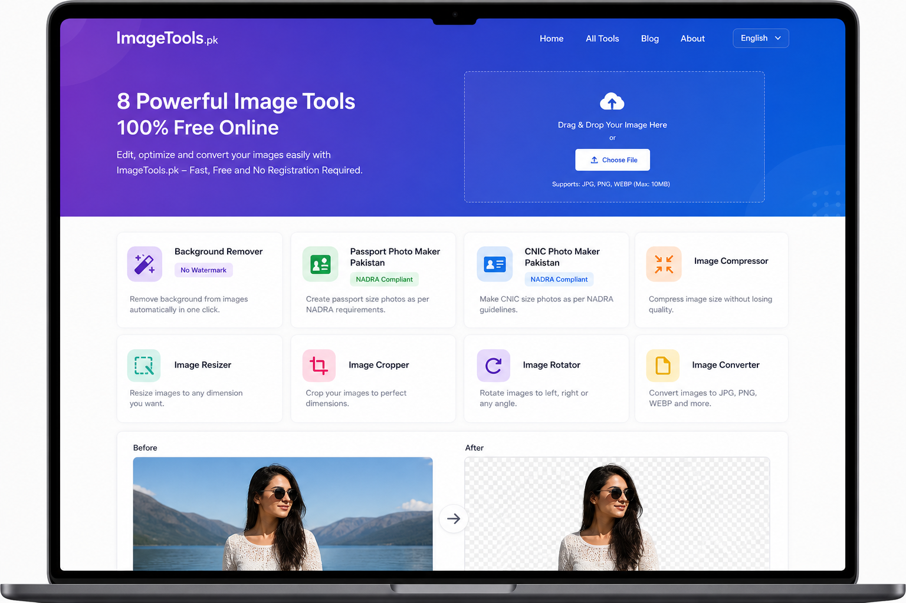</a>
<br>
<em>BG Remover No Watermark, Passport Photo NADRA, Compressor, Resizer — Before → After</em>

<br><br>

#### 📥 VideoDownloader.pk — TikTok No Watermark
<a href="https://videodownloader-pk.netlify.app/" target="_blank">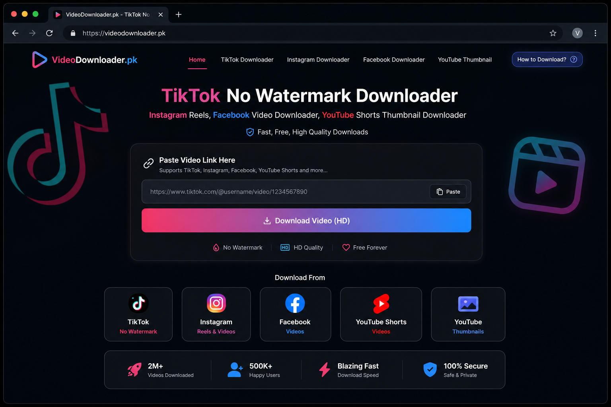</a>
<br>
<em>TikTok, Instagram Reels, Facebook HD — Paste Link → Download (HD) — 2M+ Videos Downloaded</em>

</div>

---

### 🛠️ Tech Stack

<div align="center">

#### Frontend


#### Backend & Tools


#### APIs & Libraries


</div>

---

### 📊 GitHub Stats

<div align="center">


</div>

---

### 🎯 What I Do

- 🔧 Build **useful web tools** people need daily
- 🇵🇰 Focus on **Pakistan & India** audience needs
- ⚡ Clean code, fast loading, mobile-first
- 🎨 Simple UI — anyone can use it
- 🆓 Always **FREE** — no tricks

### 🌱 Currently Learning & Exploring
- Advanced JavaScript & React
- Python Automation
- PWA & Offline-First Apps
- DevSecOps

---

### 📫 Connect With Me

<div align="center">

[](mailto:shahabkhanprofessional@gmail.com)
[](https://github.com/shahabkhan4636)
[](https://viraltools-pk.netlify.app/)

**📧 Email:** shahabkhanprofessional@gmail.com  
**📍 Location:** Islamabad, Pakistan  
**🎓 University:** Iqra University — Software Engineering

</div>

---

<div align="center">

### ⭐ If you find my tools useful, please give a star!


**© 2026 Shahab Khan — Made with ❤️ in Pakistan**

*Building tools that help — 100% Original Code*

</div>
